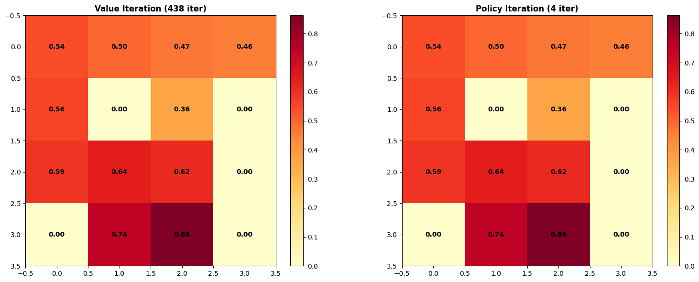
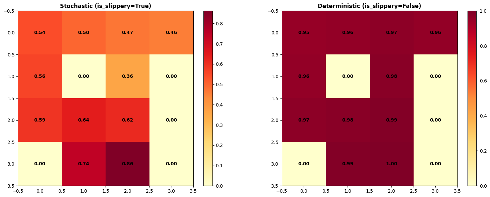
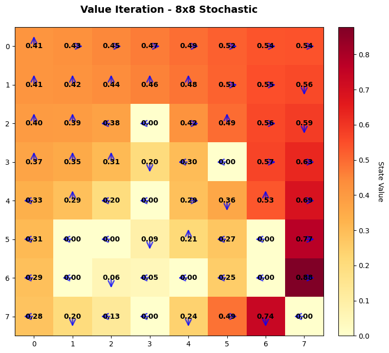
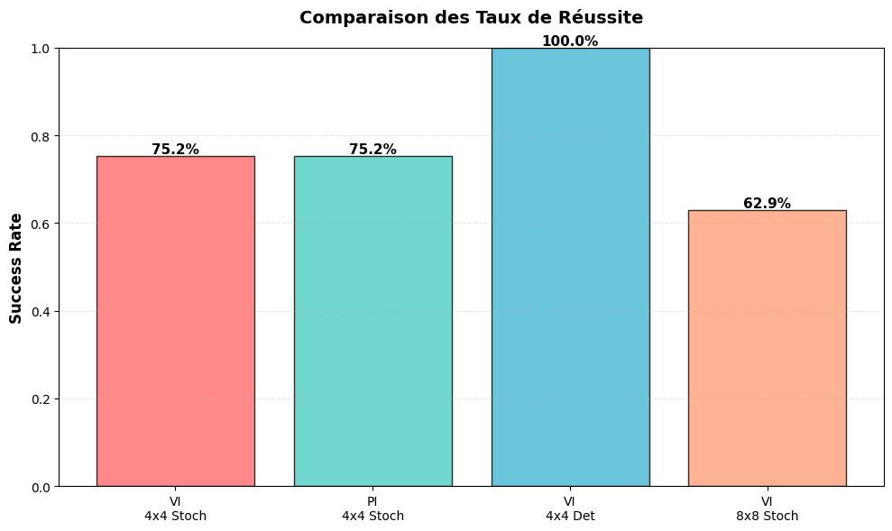

# ❄️ FrozenLake-v1 Dynamic Programming Solver

[](https://www.python.org/)
[](https://gymnasium.farama.org/environments/toy_text/frozen_lake/)
[](LICENSE)
[](https://ensate.uae.ac.ma/)
[](#authors--academic-context)

An exact model-based Reinforcement Learning study implementing and comparing **Value Iteration (VI)** and **Policy Iteration (PI)** on Gymnasium's `FrozenLake-v1` environment.

This project investigates Markov Decision Processes (MDPs), Bellman optimality equations, convergence dynamics, the impact of environmental stochasticity (slippery ice mechanics), and scalability challenges across grid sizes ($4\times4$ and $8\times8$).

---

## 📑 Table of Contents

- [Overview](#overview)
- [Markov Decision Process (MDP) Formulation](#markov-decision-process-mdp-formulation)
  - [State & Action Spaces](#state--action-spaces)
  - [Transition Dynamics & Slipping Mechanics](#transition-dynamics--slipping-mechanics)
  - [Reward Structure & Discounting](#reward-structure--discounting)
- [Algorithms](#algorithms)
  - [1. Value Iteration (VI)](#1-value-iteration-vi)
  - [2. Policy Iteration (PI)](#2-policy-iteration-pi)
- [Experimental Results](#experimental-results)
  - [Quantitative Benchmark](#quantitative-benchmark)
  - [Visualizations & Policy Heatmaps](#visualizations--policy-heatmaps)
  - [Key Insights & Analytical Takeaways](#key-insights--analytical-takeaways)
- [Repository Structure](#repository-structure)
- [Installation & Setup](#installation--setup)
- [Usage](#usage)
  - [Interactive Jupyter Notebook](#interactive-jupyter-notebook)
  - [Command-Line Interface (CLI)](#command-line-interface-cli)
- [Technical Report](#technical-report)
- [Authors & Academic Context](#authors--academic-context)
- [License](#license)

---

## 🔍 Overview

In the `FrozenLake-v1` environment, an agent navigates a frozen grid from the starting tile (**S**) to the goal (**G**), avoiding holes (**H**) and traversing safe frozen tiles (**F**).

```text
4x4 Grid Layout:
[S] [F] [F] [F]        S : Starting Point (Safe)
[F] [H] [F] [H]        F : Frozen Surface (Safe)
[F] [F] [F] [H]        H : Hole (Terminal, Reward = 0)
[H] [F] [F] [G]        G : Goal (Terminal, Reward = +1)
```

Because full access to the transition probabilities and reward distributions is available through `env.unwrapped.P`, we can solve for the exact optimal policy using **Dynamic Programming** without environmental sampling.

---

## 📐 Markov Decision Process (MDP) Formulation

The problem is formalized as a discrete, finite MDP: $\mathcal{M} = \langle \mathcal{S}, \mathcal{A}, \mathcal{P}, \mathcal{R}, \gamma \rangle$.

### State & Action Spaces
- **State Space $\mathcal{S}$**:
  - $4\times4$ grid: $|\mathcal{S}| = 16$ states ($0$ to $15$).
  - $8\times8$ grid: $|\mathcal{S}| = 64$ states ($0$ to $63$).
  - Hole states and Goal states are absorbing (terminal).
- **Action Space $\mathcal{A}$**: 4 discrete directional moves:
  $$\mathcal{A} = \{0: \text{Left } (\leftarrow), \; 1: \text{Down } (\downarrow), \; 2: \text{Right } (\rightarrow), \; 3: \text{Up } (\uparrow)\}$$

### Transition Dynamics & Slipping Mechanics
- **Deterministic (`is_slippery=False`)**: The agent transitions deterministically to the targeted adjacent tile.
- **Stochastic (`is_slippery=True`)**: When an action $a$ is selected, the agent moves in the intended direction with probability $\frac{1}{3}$, or slips orthogonally to the left or right with probability $\frac{1}{3}$ each:
  $$P(s' \mid s, a) = \begin{cases} 1/3 & \text{intended direction} \\ 1/3 & \text{perpendicular left} \\ 1/3 & \text{perpendicular right} \end{cases}$$
- Boundary collisions result in remaining in the current state.

### Reward Structure & Discounting
- **Sparse Rewards**:
  $$R(s, a, s') = \begin{cases} +1 & \text{if } s' = \text{Goal (G)} \\ 0 & \text{otherwise} \end{cases}$$
- **Hyperparameters**:
  - Discount factor: $\gamma = 0.99$ (prioritizing long-term survivability).
  - Convergence threshold: $\theta = 10^{-8}$ (ensuring high numerical precision).
  - Empirical evaluation: $N = 1{,}000$ seeded test episodes per policy.

---

## ⚙️ Algorithms

### 1. Value Iteration (VI)
Value Iteration operates directly on the state-value function using synchronous Bellman Optimality updates:

$$V_{k+1}(s) \leftarrow \max_{a \in \mathcal{A}} \sum_{s'} P(s' \mid s, a) \left[ R(s, a, s') + \gamma V_k(s') \right]$$

The algorithm iterates until value updates satisfy $\max_{s \in \mathcal{S}} |V_{k+1}(s) - V_k(s)| < \theta$, after which the optimal deterministic policy $\pi^*$ is extracted greedily:

$$\pi^*(s) = \arg\max_{a \in \mathcal{A}} \sum_{s'} P(s' \mid s, a) \left[ R(s, a, s') + \gamma V^*(s') \right]$$

### 2. Policy Iteration (PI)
Policy Iteration alternates between two explicit phases until policy stability:

1. **Policy Evaluation**: Computes the true state-value function $V^\pi$ for the current policy $\pi$:
   $$V_{k+1}^\pi(s) \leftarrow \sum_{s'} P(s' \mid s, \pi(s)) \left[ R(s, \pi(s), s') + \gamma V_k^\pi(s') \right]$$
2. **Policy Improvement**: Updates the policy greedily with respect to $V^\pi$:
   $$\pi'(s) \leftarrow \arg\max_{a \in \mathcal{A}} \sum_{s'} P(s' \mid s, a) \left[ R(s, a, s') + \gamma V^\pi(s') \right]$$

If $\pi'(s) = \pi(s)$ for all $s \in \mathcal{S}$, the policy has converged to the optimal policy $\pi^*$.

---

## 📊 Experimental Results

### Quantitative Benchmark

The table below summarizes the theoretical convergence metrics and empirical evaluation over 1,000 independent test episodes:

| Environment | Algorithm | Dynamics | Iterations | Initial State Value $V(S_0)$ | Empirical Success Rate | Average Reward |
|:---:|:---:|:---:|:---:|:---:|:---:|:---:|
| **$4\times4$** | **Value Iteration** | Stochastic (`slippery=True`) | **438** | $0.5420$ | **75.20%** | $0.7520$ |
| **$4\times4$** | **Policy Iteration** | Stochastic (`slippery=True`) | **4** | $0.5420$ | **75.20%** | $0.7520$ |
| **$4\times4$** | **Value Iteration** | Deterministic (`slippery=False`) | **7** | $0.9510$ | **100.00%** | $1.0000$ |
| **$8\times8$** | **Value Iteration** | Stochastic (`slippery=True`) | **516** | $0.4146$ | **62.90%** | $0.6290$ |

---

### Visualizations & Policy Heatmaps

#### 1. Value Iteration vs. Policy Iteration ($4\times4$ Stochastic)
Both algorithms converge to identical value functions and policies ($\|V_{\text{VI}} - V_{\text{PI}}\|_\infty < 10^{-9}$).



#### 2. Stochastic vs. Deterministic ($4\times4$)
In the deterministic environment, values follow a direct gradient toward the goal. In the stochastic environment, danger propagation from the holes depresses values across the entire grid.



#### 3. Scaling to $8\times8$ Stochastic Grid
On the larger $8\times8$ board, the agent adopts circuitous routes to maximize clearance from hole clusters.



#### 4. Empirical Success Rate Comparison
Empirical performance across all benchmarked conditions over 1,000 test episodes:



---

### 💡 Key Insights & Analytical Takeaways

1. **Policy Iteration Converges in Drastically Fewer Outer Loops**:
   - On the $4\times4$ stochastic grid, Policy Iteration required only **4 outer iterations** to reach policy stability, compared to **438 iterations** for Value Iteration.
   - While each PI iteration involves an inner policy evaluation, policy space converges much faster than the full value space.

2. **Emergence of Risk-Averse Trajectories under Stochasticity**:
   - In deterministic mode, the optimal policy selects the shortest Manhattan path (success rate = $100\%$, $V(S_0) \approx 0.9510$).
   - When slipping is enabled, the agent deliberately steers into walls and takes indirect detours. This minimizes the risk of sliding perpendicularly into holes, trading speed for survival (success rate = $75.2\%$, $V(S_0) \approx 0.5420$).

3. **Curse of Dimensionality on $8\times8$ Grid**:
   - Expanding from $4\times4$ to $8\times8$ quadruples the state space ($16 \rightarrow 64$).
   - Long paths compound the cumulative probability of slipping into hazards, reducing the empirical success rate from $75.2\%$ to $62.9\%$, while iterations grow to $516$.

---

## 📂 Repository Structure

```text
Reinforcement-learning_Frozen-Lake/
├── assets/                                 # Generated visualization figures & benchmark plots
│   ├── comparison_vi_vs_pi.png
│   ├── empirical_success_rates.png
│   ├── frozenlake_grid_4x4.png
│   ├── policy_iteration_4x4.png
│   ├── stochastic_vs_deterministic.png
│   ├── value_iteration_4x4.png
│   └── value_iteration_8x8.png
├── docs/                                   # Technical documentation & assignment reports
│   └── Reinforcement_Learning_Assignment.pdf
├── notebooks/                              # Interactive Jupyter Notebook experiments
│   └── Frozen_Lake_Notebook.ipynb
├── src/                                    # Modular Python implementation
│   ├── __init__.py
│   ├── dynamic_programming.py             # Value Iteration & Policy Iteration implementations
│   ├── environment.py                     # Gymnasium environment helpers
│   ├── evaluation.py                      # Empirical policy evaluation over N episodes
│   └── visualization.py                   # Heatmap and policy arrow visualizers
├── .gitignore                              # Clean Python/Jupyter gitignore
├── LICENSE                                 # MIT License
├── main.py                                 # Command-line benchmark runner
├── README.md                               # Project documentation
└── requirements.txt                        # Pinned dependencies
```

---

## 🚀 Installation & Setup

### Prerequisites
- Python 3.9+
- pip package manager

### 1. Clone the Repository
```bash
git clone https://github.com/yassiradila/Reinforcement-learning_Frozen-Lake.git
cd Reinforcement-learning_Frozen-Lake
```

### 2. Create and Activate a Virtual Environment
```bash
# On Linux / macOS
python3 -m venv .venv
source .venv/bin/activate

# On Windows (PowerShell)
python -m venv .venv
.venv\Scripts\Activate.ps1
```

### 3. Install Dependencies
```bash
pip install -r requirements.txt
```

---

## 💻 Usage

### Interactive Jupyter Notebook
Launch Jupyter Lab or Notebook to run the experiments, plot heatmaps, and inspect the code interactively:

```bash
jupyter notebook notebooks/Frozen_Lake_Notebook.ipynb
```

### Command-Line Interface (CLI)
You can execute the full benchmark suite directly from your terminal:

```bash
# Run standard benchmark
python main.py

# Run benchmark with customized parameters and save figures to assets/
python main.py --gamma 0.99 --theta 1e-8 --episodes 1000 --save-plots
```

#### CLI Arguments:
- `--gamma` *(float, default: 0.99)*: MDP discount factor.
- `--theta` *(float, default: 1e-8)*: Bellman convergence threshold.
- `--episodes` *(int, default: 1000)*: Number of empirical test episodes.
- `--save-plots` *(flag)*: Export generated figures to `--assets-dir`.
- `--assets-dir` *(str, default: assets)*: Destination directory for figures.

---

## 📄 Technical Report

A complete 10-page academic report detailing Bellman equations, transition probabilities, algorithm derivations, and theoretical proofs is available in:
- 📖 **[Reinforcement_Learning_Assignment.pdf](docs/Reinforcement_Learning_Assignment.pdf)**

---

## 👥 Authors & Academic Context

Developed at the **National School of Applied Sciences of Tétouan (ENSA Tétouan)**  
**Department:** Artificial Intelligence and Digitalization (IAD)  
**Program:** Data Science, Big Data, and Artificial Intelligence (BDIA2)  
**Academic Year:** 2025–2026  

- **Aymane Hayoun**
- **Yassir Adila** ([@yassiradila](https://github.com/yassiradila))

**Supervised by:**  
- **Pr. A. Belcaid**

---

## 📜 License

This project is licensed under the MIT License - see the [LICENSE](LICENSE) file for details.